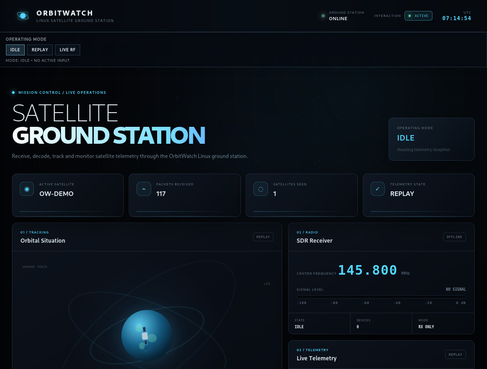
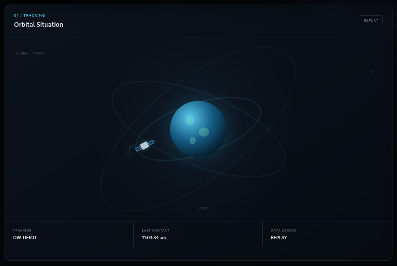
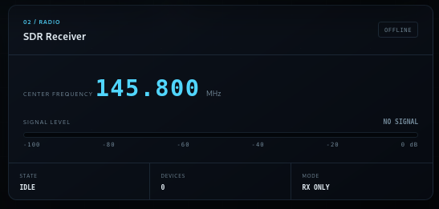
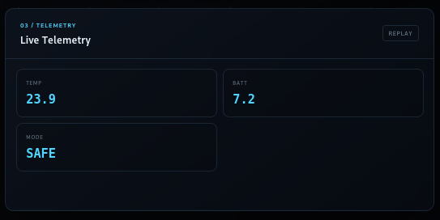
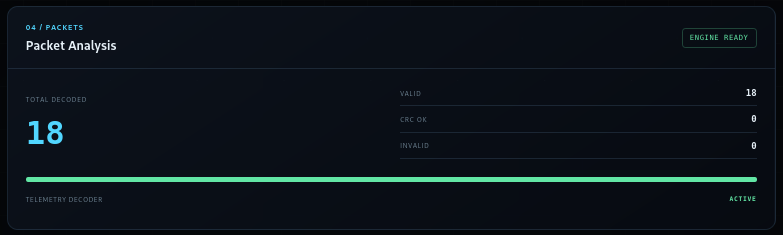
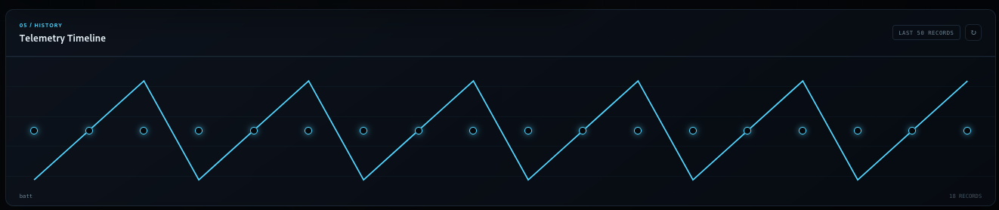
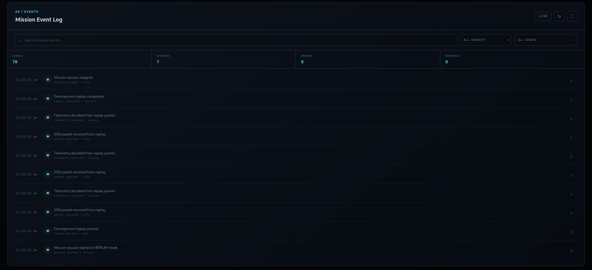
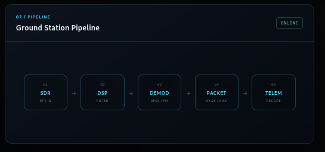

# OrbitWatch — Linux Satellite Ground Station

<p align="center">
  
</p>

<p align="center">
  <strong>Linux-based satellite ground-station software for SDR reception, signal processing, packet decoding, telemetry analysis, orbit tracking, mission recording, and Mission Control visualization.</strong>
</p>

<p align="center">
  <a href="#overview">Overview</a> •
  <a href="#architecture">Architecture</a> •
  <a href="#features">Features</a> •
  <a href="#installation">Installation</a> •
  <a href="#usage">Usage</a> •
  <a href="#testing">Testing</a> •
  <a href="#documentation">Documentation</a>
</p>

<p align="center">
  
  
  
  
  
  
  
  
</p>

---

## Overview

**OrbitWatch** is a Linux-based satellite ground-station software project designed around the complete receive-side telemetry workflow:

```text
Satellite
   │
   ▼
Antenna
   │
   ▼
SDR Receiver
   │
   ▼
IQ Samples
   │
   ▼
Signal Processing
   │
   ├── Filtering
   ├── Synchronization
   └── Demodulation
   │
   ▼
Packet Decoder
   │
   ├── KISS
   └── AX.25
   │
   ▼
Telemetry Engine
   │
   ├── Parsing
   ├── Validation
   └── Storage
   │
   ├───────────────┐
   ▼               ▼
Orbit / Pass     Mission
Tracking         Recording
   │               │
   └───────┬───────┘
           ▼
    Mission Control
       Dashboard
```

The project combines **software-defined radio concepts, digital signal processing, packet protocols, telemetry engineering, satellite orbit calculations, recording/replay, mission logging, and a web-based Mission Control interface** into one modular system.

The design is intentionally receive-oriented:

> **OrbitWatch does not transmit RF.**

The development environment includes a controlled replay/simulation mode so the complete software pipeline can be demonstrated without requiring a live satellite pass or RF transmission.

---

# Project Highlights

* 🛰️ Satellite catalog and orbital calculations
* 🌍 Satellite pass prediction
* 📡 SDR device abstraction
* 📶 IQ sample handling
* 🔬 Digital signal-processing components
* 🎛️ Filtering and signal synchronization
* 📻 Demodulation pipeline
* 📦 KISS frame decoding
* 🛰️ AX.25 packet decoding
* 📊 Telemetry parsing and validation
* 🗄️ SQLite telemetry persistence
* 🎥 Event recording and replay
* 📝 Mission logging
* 🧪 Controlled development replay
* 🖥️ Mission Control web dashboard
* 🔄 Runtime operating-state management
* 🧩 Modular Python architecture
* 🧪 Automated test suite
* 🔐 Receive-only safety model
* 📚 Engineering documentation

---

# Mission Control Dashboard

OrbitWatch includes a dedicated Mission Control dashboard designed to provide a unified operational view of the ground-station pipeline.

The dashboard brings together:

* operating mode
* satellite information
* telemetry
* packet information
* signal/radio status
* orbit and pass information
* mission events
* recordings
* pipeline state

<p align="center">
  
</p>

---

# Operating Modes

OrbitWatch separates **current operating state** from historical telemetry and mission data.

This is important because previously recorded telemetry should not automatically determine the current operating mode of the ground station.

## IDLE

The ground station is not actively receiving or replaying a mission.

```text
MODE: IDLE
DATA SOURCE: NONE
STATUS: IDLE
```

No live RF session is implied.

---

## REPLAY / DEVELOPMENT

Replay mode uses controlled development data to exercise the telemetry and mission pipeline.

```text
MODE: REPLAY / DEVELOPMENT
DATA SOURCE: REPLAY
```

This mode is useful for:

* dashboard development
* telemetry testing
* packet decoding validation
* recording/replay testing
* Mission Control demonstrations
* software integration testing

Replay data is **controlled development data** and must not be interpreted as a claim of live satellite reception.

---

## LIVE RF

The architecture supports a live receive-side SDR workflow.

```text
MODE: LIVE RF
DATA SOURCE: SDR
```

Live RF mode is intended for an actual receive chain:

```text
Antenna
   ↓
SDR
   ↓
IQ
   ↓
Signal Processing
   ↓
Demodulation
   ↓
Packet Decoding
   ↓
Telemetry
```

The dashboard itself does not create a fake live RF session.

RF transmission is disabled by design.

---

# Screenshots

## Mission Control

<p align="center">
  
</p>

The main Mission Control interface provides the operational overview of OrbitWatch.

---

## Orbit Tracking

<p align="center">
  
</p>

OrbitWatch includes satellite orbital calculations and pass-prediction functionality.

---

## Radio / SDR

<p align="center">
  
</p>

The radio subsystem provides the software abstraction required for SDR-based receive workflows.

---

## Live Telemetry

<p align="center">
  
</p>

The telemetry interface presents decoded and processed telemetry information to Mission Control.

Live-mode functionality should only be interpreted as live when backed by an actual receive-side data source.

---

## Packet Analysis

<p align="center">
  
</p>

Packet processing includes protocol-oriented handling of KISS and AX.25 frames.

---

## Telemetry Timeline

<p align="center">
  
</p>

Telemetry events can be represented chronologically for mission analysis and debugging.

---

## Mission Log

<p align="center">
  
</p>

Mission events are recorded independently from the current runtime state.

---

## Pipeline

<p align="center">
  
</p>

The pipeline view illustrates the receive-side data flow from radio input through telemetry processing.

---

# System Architecture

OrbitWatch is organized as a collection of focused subsystems.

```text
                    ┌─────────────────────┐
                    │     Satellite       │
                    └──────────┬──────────┘
                               │
                               ▼
                    ┌─────────────────────┐
                    │    SDR Subsystem    │
                    │ Device / IQ / RX    │
                    └──────────┬──────────┘
                               │
                               ▼
                    ┌─────────────────────┐
                    │ Signal Processing   │
                    │ Filter / Sync / Demod│
                    └──────────┬──────────┘
                               │
                               ▼
                    ┌─────────────────────┐
                    │ Protocol Processing │
                    │ KISS / AX.25        │
                    └──────────┬──────────┘
                               │
                               ▼
                    ┌─────────────────────┐
                    │ Telemetry Engine    │
                    │ Decode / Parse / DB  │
                    └──────────┬──────────┘
                               │
              ┌────────────────┼────────────────┐
              │                │                │
              ▼                ▼                ▼
       ┌────────────┐   ┌────────────┐   ┌────────────┐
       │   Orbit    │   │  Mission   │   │ Recording  │
       │  Tracking  │   │   Logger   │   │  / Replay  │
       └──────┬─────┘   └──────┬─────┘   └──────┬─────┘
              │                │                │
              └────────────────┼────────────────┘
                               ▼
                    ┌─────────────────────┐
                    │  Mission Control    │
                    │      Dashboard      │
                    └─────────────────────┘
```

---

# Runtime State Architecture

OrbitWatch maintains a dedicated runtime state separate from historical mission and telemetry data.

```text
                     Runtime State
                          │
                          ▼
                 data/runtime/state.json
                          │
             ┌────────────┼────────────┐
             │            │            │
             ▼            ▼            ▼
           IDLE         REPLAY        LIVE
             │            │            │
             │            │            │
             │            ▼            ▼
             │       Development      SDR
             │         Replay        Receiver
             │
             └───────────────────────────────┐
                                             ▼
                                  Mission Control
```

This separation prevents historical replay records from incorrectly determining the current operating mode.

For example, after a replay session finishes:

```text
Historical data:
    remains available

Current runtime:
    returns to IDLE
```

This provides a cleaner distinction between:

* what happened previously
* what the system is doing now

---

# Repository Structure

The project is organized into independent modules.

```text
Linux-Satellite-Ground-Station/
│
├── assets/
│   ├── demo/
│   └── screenshots/
│       ├── dashboard.png
│       ├── live-telemetry.png
│       ├── mission-log.png
│       ├── orbit-tracking.png
│       ├── packet-analysis.png
│       ├── pipeline.png
│       ├── radio.png
│       └── telemetry-timeline.png
│
├── data/
│   ├── mission/
│   ├── recordings/
│   │   ├── events/
│   │   └── iq/
│   ├── runtime/
│   ├── samples/
│   ├── satellites/
│   └── telemetry/
│
├── docs/
│   ├── architecture.md
│   ├── operations.md
│   ├── protocols.md
│   ├── radio.md
│   └── telemetry.md
│
├── scripts/
│   ├── run.sh
│   ├── setup.sh
│   └── test.sh
│
├── src/
│   ├── main.py
│   │
│   └── groundstation/
│       ├── cli.py
│       ├── config.py
│       ├── runtime.py
│       │
│       ├── dashboard/
│       │   ├── app.py
│       │   ├── routes.py
│       │   ├── static/
│       │   └── templates/
│       │
│       ├── mission/
│       │   ├── database.py
│       │   ├── logger.py
│       │   ├── models.py
│       │   └── service.py
│       │
│       ├── pipeline/
│       │   ├── models.py
│       │   └── receiver_pipeline.py
│       │
│       ├── protocols/
│       │   ├── ax25.py
│       │   ├── kiss.py
│       │   └── telemetry.py
│       │
│       ├── recording/
│       │   ├── event_recorder.py
│       │   ├── iq_recorder.py
│       │   ├── models.py
│       │   ├── reader.py
│       │   ├── replay.py
│       │   └── service.py
│       │
│       ├── satellites/
│       │   ├── catalog.py
│       │   ├── orbit.py
│       │   └── pass_predictor.py
│       │
│       ├── sdr/
│       │   ├── device.py
│       │   ├── iq.py
│       │   └── receiver.py
│       │
│       ├── signal/
│       │   ├── demodulator.py
│       │   ├── filter.py
│       │   └── synchronizer.py
│       │
│       ├── simulation/
│       │   ├── mission.py
│       │   └── samples.py
│       │
│       └── telemetry/
│           ├── database.py
│           ├── decoder.py
│           ├── engine.py
│           └── parser.py
│
├── tests/
│   ├── test_api.py
│   ├── test_ax25.py
│   ├── test_database.py
│   ├── test_kiss.py
│   ├── test_mission_log.py
│   ├── test_orbit.py
│   ├── test_pass_prediction.py
│   ├── test_pipeline.py
│   ├── test_recording.py
│   ├── test_runtime.py
│   ├── test_runtime_api.py
│   ├── test_satellites.py
│   ├── test_sdr.py
│   ├── test_signal.py
│   ├── test_simulation.py
│   ├── test_telemetry.py
│   └── test_telemetry_engine.py
│
├── .github/
│   └── workflows/
│       └── tests.yml
│
├── CHANGELOG.md
├── CODE_OF_CONDUCT.md
├── CONTRIBUTING.md
├── LICENSE
├── README.md
├── requirements.txt
├── SECURITY.md
└── pytest.ini
```

Generated runtime files such as Python bytecode, pytest caches, databases, replay recordings, and runtime state should be excluded from the public source tree through `.gitignore` where appropriate.

---

# Core Components

## 1. Satellite Catalog

The satellite subsystem provides the foundation for working with satellite identities and orbital information.

Relevant modules:

```text
src/groundstation/satellites/
├── catalog.py
├── orbit.py
└── pass_predictor.py
```

Responsibilities include:

* satellite catalog management
* orbital calculations
* pass prediction
* tracking-related calculations

---

# 2. SDR Subsystem

The SDR subsystem provides an abstraction between the ground-station software and radio hardware.

```text
src/groundstation/sdr/
├── device.py
├── iq.py
└── receiver.py
```

The design separates:

```text
SDR Device
    ↓
Receiver
    ↓
IQ Samples
```

This allows the higher-level processing pipeline to remain independent from a specific SDR implementation.

---

# 3. Signal Processing

Signal-processing functionality is organized under:

```text
src/groundstation/signal/
├── filter.py
├── synchronizer.py
└── demodulator.py
```

The receive chain is conceptually:

```text
IQ Samples
    ↓
Filtering
    ↓
Synchronization
    ↓
Demodulation
    ↓
Protocol Frames
```

The project uses numerical and scientific Python libraries for signal-processing operations.

---

# 4. Packet Protocols

OrbitWatch contains protocol-processing modules for:

* KISS
* AX.25
* telemetry payloads

```text
src/groundstation/protocols/
├── kiss.py
├── ax25.py
└── telemetry.py
```

The protocol layer separates raw frame processing from higher-level telemetry interpretation.

---

# 5. Telemetry Engine

The telemetry subsystem is responsible for converting decoded packet information into structured telemetry data.

```text
src/groundstation/telemetry/
├── database.py
├── decoder.py
├── engine.py
└── parser.py
```

Conceptually:

```text
Decoded Packet
      ↓
Telemetry Decoder
      ↓
Telemetry Parser
      ↓
Validation
      ↓
Telemetry Engine
      ↓
SQLite Database
```

This allows telemetry to be consumed by both the Mission Control dashboard and mission-recording components.

---

# 6. Mission Recording

OrbitWatch records mission events independently from the current runtime mode.

```text
src/groundstation/recording/
├── event_recorder.py
├── iq_recorder.py
├── models.py
├── reader.py
├── replay.py
└── service.py
```

The recording architecture supports:

* event recording
* IQ recording abstraction
* recording metadata
* reading recordings
* replay
* mission data inspection

Event recordings can be represented as JSON/JSONL data.

---

# 7. Development Simulation

The development simulation subsystem allows the complete software workflow to be tested without requiring live satellite RF reception.

```text
src/groundstation/simulation/
├── mission.py
└── samples.py
```

Development replay is intentionally labeled as:

```text
REPLAY / DEVELOPMENT
```

This distinction is important for technical accuracy and prevents simulated telemetry from being presented as live satellite data.

---

# 8. Mission Logging

Mission logging provides a historical record of operational events.

```text
src/groundstation/mission/
├── database.py
├── logger.py
├── models.py
└── service.py
```

Mission history is separate from runtime state.

For example:

```text
Mission History
       │
       ├── Previous Replay
       ├── Recorded Events
       └── Historical Telemetry

Current Runtime
       │
       └── IDLE
```

---

# Installation

## Requirements

Recommended environment:

* Linux
* Python 3.10+
* `pip`
* virtual environment support
* Git

The project has been developed and tested in a Linux/Kali environment.

---

## Clone the Repository

```bash
git clone <YOUR-REPOSITORY-URL>
cd Linux-Satellite-Ground-Station
```

Replace `<YOUR-REPOSITORY-URL>` with the URL of your GitHub repository.

---

## Create a Virtual Environment

```bash
python3 -m venv .venv
```

Activate it:

```bash
source .venv/bin/activate
```

---

## Upgrade pip

```bash
python -m pip install --upgrade pip
```

---

## Install Dependencies

```bash
pip install -r requirements.txt
```

The main dependencies include:

```text
Flask
NumPy
SciPy
Skyfield
SGP4
pytest
```

---

# Quick Setup

The project also includes a setup script.

```bash
chmod +x scripts/setup.sh
./scripts/setup.sh
```

If you prefer manual installation, follow the virtual-environment instructions above.

---

# Running OrbitWatch

## Start Mission Control

From the project root:

```bash
./scripts/run.sh dashboard
```

The dashboard starts the Flask Mission Control application.

Then open:

```text
http://127.0.0.1:5000
```

The dashboard is designed as a read-oriented Mission Control interface.

---

# Running Development Replay

To execute the controlled development mission:

```bash
./scripts/run.sh demo
```

The replay exercises the software pipeline using controlled development data.

A typical result follows this general structure:

```text
OrbitWatch Development Replay
==============================
STATUS: COMPLETED
MODE:   REPLAY / DEVELOPMENT

Packets processed: ...
Packets decoded:   ...
Packets failed:    ...

Telemetry DB: ...
Mission DB:   ...
Recording:    ...

The data is controlled development/replay data.
No live RF transmission was performed.
```

The exact values depend on the replay execution.

---

# Command-Line Usage

The project entry point is:

```bash
python -m src.main
```

The helper script provides the most convenient interface:

```bash
./scripts/run.sh help
```

Available operations include:

```text
./scripts/run.sh dashboard
./scripts/run.sh demo
./scripts/run.sh help
```

---

# Testing

OrbitWatch includes an automated test suite covering the major subsystems.

Run the complete suite with:

```bash
pytest -q
```

Or use the provided test script:

```bash
./scripts/test.sh
```

The test suite covers areas including:

```text
API
AX.25
Database
KISS
Mission Logging
Orbit Calculations
Pass Prediction
Pipeline
Recording
Runtime State
Runtime API
Satellite Catalog
SDR
Signal Processing
Simulation
Telemetry
Telemetry Engine
```

A successful test run provides confidence that changes to individual subsystems do not silently break the broader ground-station architecture.

---

# Continuous Integration

GitHub Actions is configured under:

```text
.github/workflows/tests.yml
```

The CI workflow is intended to automatically validate the project test suite when changes are pushed to the repository.

---

# Data Storage

OrbitWatch uses a local data hierarchy:

```text
data/
├── mission/
├── recordings/
│   ├── events/
│   └── iq/
├── runtime/
├── samples/
├── satellites/
└── telemetry/
```

## Mission Database

```text
data/mission/
```

Stores mission-related persistent information.

## Telemetry Database

```text
data/telemetry/
```

Stores structured telemetry information.

## Runtime State

```text
data/runtime/state.json
```

Stores the current operating state.

## Recordings

```text
data/recordings/
```

Contains event and IQ recording infrastructure.

Runtime-generated recordings and databases should normally be excluded from a clean public source repository unless intentionally included as reproducible demonstration artifacts.

---

# Safety Model

OrbitWatch is designed around a receive-side ground-station architecture.

## RF Transmission

```text
RF TRANSMISSION: DISABLED
```

The project does not provide a mechanism for arbitrary RF transmission.

The intended workflow is:

```text
RF Reception
     ↓
Processing
     ↓
Decoding
     ↓
Telemetry
     ↓
Analysis
```

not:

```text
Software
     ↓
RF Transmission
```

---

# Live RF vs Development Replay

This distinction is fundamental to the project.

| Capability               | Development Replay |                            Live RF |
| ------------------------ | -----------------: | ---------------------------------: |
| Controlled sample data   |                  ✅ |                                  ❌ |
| Actual SDR input         |                  ❌ |                                  ✅ |
| Packet processing        |                  ✅ |                                  ✅ |
| Telemetry pipeline       |                  ✅ |                                  ✅ |
| Dashboard visualization  |                  ✅ |                                  ✅ |
| Mission recording        |                  ✅ |                                  ✅ |
| Real satellite reception |                  ❌ | Only with actual RF hardware/input |
| RF transmission          |                  ❌ |                                  ❌ |

The development replay mode exists to validate the software architecture without pretending that simulated packets represent real satellite observations.

---

# Engineering Design Principles

OrbitWatch follows several engineering principles.

### Modular Architecture

Each subsystem has a focused responsibility.

```text
SDR
 ↓
Signal
 ↓
Protocol
 ↓
Telemetry
 ↓
Mission
 ↓
Dashboard
```

### Separation of Concerns

Radio handling, signal processing, protocol decoding, telemetry processing, mission recording, and dashboard presentation are implemented as separate modules.

### Testability

Subsystems are independently testable.

### Reproducibility

Development replay provides a deterministic environment for demonstrating the processing workflow without requiring a live satellite pass.

### Runtime/Data Separation

Current system state is separated from historical mission data.

### Safety

RF transmission is disabled.

### Transparency

Controlled development data is explicitly labeled rather than being represented as live telemetry.

---

# Technical Stack

| Layer                | Technology              |
| -------------------- | ----------------------- |
| Language             | Python                  |
| Operating System     | Linux                   |
| Web Dashboard        | Flask                   |
| Numerical Computing  | NumPy                   |
| Scientific Computing | SciPy                   |
| Orbital Mechanics    | Skyfield / SGP4         |
| Database             | SQLite                  |
| Packet Protocols     | KISS / AX.25            |
| Testing              | pytest                  |
| CI                   | GitHub Actions          |
| Visualization        | HTML / CSS / JavaScript |
| Data Format          | JSON / JSONL            |
| Radio Architecture   | SDR / IQ abstraction    |

---

# Project Workflow

A complete receive-side workflow can be represented as:

```text
┌───────────────────────┐
│ Satellite / RF Source│
└───────────┬───────────┘
            │
            ▼
┌───────────────────────┐
│      SDR Receiver     │
└───────────┬───────────┘
            │
            ▼
┌───────────────────────┐
│      IQ Samples       │
└───────────┬───────────┘
            │
            ▼
┌───────────────────────┐
│ Signal Processing     │
│                       │
│ Filter                │
│ Synchronizer          │
│ Demodulator           │
└───────────┬───────────┘
            │
            ▼
┌───────────────────────┐
│ Protocol Decoding     │
│                       │
│ KISS                  │
│ AX.25                 │
└───────────┬───────────┘
            │
            ▼
┌───────────────────────┐
│ Telemetry Engine      │
│                       │
│ Decode                │
│ Parse                 │
│ Validate              │
│ Store                 │
└───────────┬───────────┘
            │
       ┌────┴─────┐
       ▼          ▼
┌────────────┐ ┌────────────┐
│ Orbit /    │ │ Mission /  │
│ Pass       │ │ Recording  │
│ Tracking   │ │            │
└──────┬─────┘ └─────┬──────┘
       │             │
       └──────┬──────┘
              ▼
      ┌───────────────┐
      │ Mission       │
      │ Control       │
      │ Dashboard     │
      └───────────────┘
```

---

# Documentation

Detailed technical documentation is available under `docs/`.

### Architecture

[`docs/architecture.md`](docs/architecture.md)

Covers:

* system architecture
* module relationships
* processing pipeline
* runtime state
* data flow

### Operations

[`docs/operations.md`](docs/operations.md)

Covers:

* starting the dashboard
* development replay
* operating modes
* runtime behavior
* troubleshooting

### Protocols

[`docs/protocols.md`](docs/protocols.md)

Covers:

* KISS
* AX.25
* packet processing
* telemetry payload handling

### Radio

[`docs/radio.md`](docs/radio.md)

Covers:

* SDR concepts
* IQ data
* receive architecture
* signal-processing path
* RF safety

### Telemetry

[`docs/telemetry.md`](docs/telemetry.md)

Covers:

* telemetry processing
* parsing
* decoding
* storage
* dashboard consumption

---

# Development Workflow

A typical development workflow is:

```bash
git clone <YOUR-REPOSITORY-URL>
cd Linux-Satellite-Ground-Station

python3 -m venv .venv
source .venv/bin/activate

pip install -r requirements.txt

pytest -q

./scripts/run.sh dashboard
```

For pipeline demonstrations:

```bash
./scripts/run.sh demo
```

---

# Troubleshooting

## Dashboard Does Not Start

Verify that the virtual environment is active:

```bash
source .venv/bin/activate
```

Verify dependencies:

```bash
pip install -r requirements.txt
```

Then run:

```bash
./scripts/run.sh dashboard
```

---

## Tests Fail During Import

Ensure the project is being executed from the repository root.

```bash
cd Linux-Satellite-Ground-Station
```

Then:

```bash
pytest -q
```

---

## Replay Does Not Start

Check the runtime state:

```bash
cat data/runtime/state.json
```

Then run:

```bash
./scripts/run.sh demo
```

The replay process should return the runtime state to `IDLE` after completion.

---

# Security Considerations

OrbitWatch is intended for receive-side satellite ground-station experimentation and software engineering.

Security considerations include:

* no RF transmission
* controlled development replay
* separation of runtime state and historical data
* validation of decoded data
* local database storage
* modular subsystem boundaries
* explicit development/live mode separation

See:

[`SECURITY.md`](SECURITY.md)

for the project's security policy.

---

# Contributing

Contributions are welcome when they improve the reliability, clarity, safety, or maintainability of the project.

Recommended workflow:

```text
Fork
  ↓
Create Branch
  ↓
Implement Change
  ↓
Run Tests
  ↓
Review Documentation
  ↓
Open Pull Request
```

See:

[`CONTRIBUTING.md`](CONTRIBUTING.md)

for contribution guidelines.

---

# Project Roadmap

Potential future development areas include:

* additional SDR hardware integrations
* expanded modulation support
* additional satellite protocols
* stronger synchronization algorithms
* richer telemetry schemas
* enhanced orbit visualization
* Doppler-aware receive processing
* more sophisticated pass tracking
* IQ recording and analysis workflows
* expanded Mission Control analytics
* hardware-in-the-loop testing
* additional automated integration tests

Future features should preserve the project's receive-only safety model and clear separation between real RF input and development/replay data.

---

# Why OrbitWatch?

OrbitWatch was designed as a practical systems-engineering project rather than a single-purpose script.

It demonstrates the ability to work across multiple technical layers:

```text
Linux
  ↓
Python
  ↓
SDR
  ↓
Digital Signal Processing
  ↓
Communication Protocols
  ↓
Telemetry
  ↓
Databases
  ↓
Orbit Computation
  ↓
Mission Logging
  ↓
Web Dashboard
  ↓
Automated Testing
```

This makes the project relevant to areas such as:

* Software Engineering
* Embedded Systems
* Software-Defined Radio
* Digital Signal Processing
* Satellite Communications
* Network/Protocol Engineering
* Telemetry Systems
* Linux Engineering
* Python Development
* Data Processing
* Systems Integration

---

# Portfolio Value

OrbitWatch demonstrates experience with:

* designing a multi-module Python application
* building a receive-side SDR architecture
* processing IQ-oriented data
* implementing signal-processing stages
* decoding communication protocols
* building a telemetry pipeline
* designing persistent data models
* implementing orbital calculations
* building recording/replay infrastructure
* developing a Flask-based operational dashboard
* separating runtime state from historical data
* writing automated tests
* creating CI workflows
* documenting a complete technical system
* designing software with explicit safety boundaries

The project is intended to demonstrate **engineering depth across the complete receive-side satellite data path**, rather than only a dashboard or isolated algorithm.

---

# Project Status

OrbitWatch is an actively developed portfolio project.

Current implementation includes:

```text
✓ Project foundation
✓ Satellite catalog
✓ Orbit calculations
✓ Pass prediction
✓ SDR subsystem
✓ IQ abstraction
✓ Signal processing
✓ Packet decoding
✓ KISS processing
✓ AX.25 processing
✓ Telemetry engine
✓ Telemetry storage
✓ Mission logging
✓ Event recording
✓ Replay infrastructure
✓ Development simulation
✓ Mission Control dashboard
✓ Runtime state management
✓ Automated tests
✓ GitHub Actions
✓ Technical documentation
```

Live RF reception should only be considered operational when connected to a real receive-side SDR/data source and appropriate antenna/radio setup.

---

# License

This project is distributed under the license contained in:

[`LICENSE`](LICENSE)

---

# Author

**Ch Viswa**

Cybersecurity / Systems Engineering Portfolio

Areas of interest:

* Cybersecurity
* Linux
* Python
* Software-Defined Radio
* Satellite Systems
* Network Security
* Security Operations
* Systems Engineering

---

<p align="center">
  <strong>OrbitWatch</strong><br>
  From RF reception to telemetry intelligence.
</p>

<p align="center">
  <sub>Built for learning, engineering, experimentation, and portfolio demonstration.</sub>
</p>
